# Amherst Run

[](https://github.com/jeremylegere-wq/amherst-run/actions/workflows/ci.yml)
[](LICENSE)

A retro open-world arcade driving game set in **Amherst, Nova Scotia**.
Cruise the real street network, take jobs from the town's landmarks and keep ahead of the police.
Driving only, no on-foot gameplay. Pure Python + pygame, drawn as chunky 320x180 (16:9) cel-shaded polygons and scaled
up to your screen.

> **Native C++ version:** [amherst-run-native](https://github.com/jeremylegere-wq/amherst-run-native) is a rebuild of this game in C++ (SDL2, OpenGL ES 3) for Xbox in Developer Mode, Android and Linux. This Python game remains the reference it is tested against.

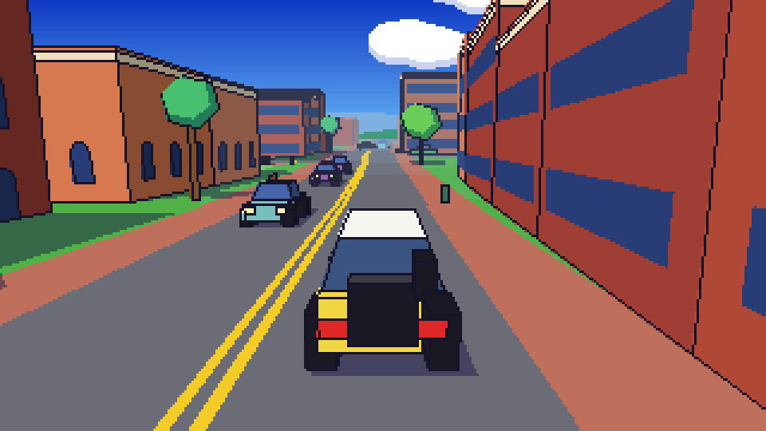

It runs on a desktop (Windows, macOS, Linux), on **Batocera** with an Xbox-style controller, and on **Android**
with on-screen touch controls.

**Native version:** [amherst-run-native](https://github.com/jeremylegere-wq/amherst-run-native) is the C++ port
(SDL2 + OpenGL ES) for an Xbox One in Developer Mode, Android and Linux, with tagging, music and a bolder street look
of its own. It loads this repository's baked map from each release. Its Xbox and Android builds are untested on real
hardware so far.

### What is real
- **Streets** from the Nova Scotia Road Network: real names, one-ways, overpasses on Highway 104, speed limits.
- **Buildings, parks and landmarks** from OpenStreetMap: the red sandstone downtown, the Court House, Victoria Square
  and its war memorial, the Dominion Building, churches, banks, the County Museum, the border welcome lighthouse at
  Highway 104 Exit 1, the Pumping Station dam, and the wind turbines on the marsh skyline.
- **The country roads east of town**: the loop out Church St and Hastings Rd round to Highway 6, and on toward Warren
  and Tyndal Road, with every rural home placed where the LiDAR survey shows its roof (OpenStreetMap maps few of them).
- **Parking lots** from OpenStreetMap: the mall, Walmart, the Superstore and the high school lots are open pavement
  with painted stalls, not a tangle of driveways.
- **Downtown murals**: the North Nova Scotia Highlanders memorial and The Great Amherst Mystery, as simplified panels.
- **Building heights and roof shapes** measured from a 2020 LiDAR survey: every house's real height, and whether
  its roof is flat, gabled (either way round) or hipped.
- **Hills** from real elevation data: downtown sits on its ridge, the Tantramar marsh is flat at sea level.
- **House numbers** from the Nova Scotia Civic Address File: parcel jobs send you to real addresses.
- **Woods and zoning** from provincial open data, so each district looks like itself.
- **Traffic lights and stop signs** from OpenStreetMap, which the town's traffic obeys, with right of way everywhere else.
- **Heritage buildings** modelled from the Canadian Register of Historic Places and reference photos: the old post
  office's clock tower, the Court House, the Dominion Building, the churches' towers, Victorian and Greek Revival houses,
  and two demolished landmarks (the 1906 Bank of Montreal and the Hickman Street school) put back where they stood.

| | |
|---|---|
| 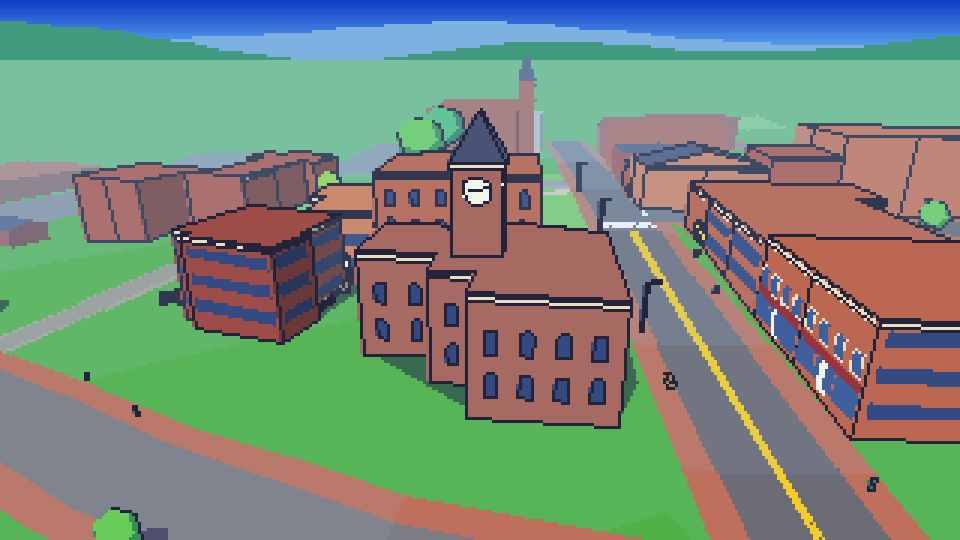 | 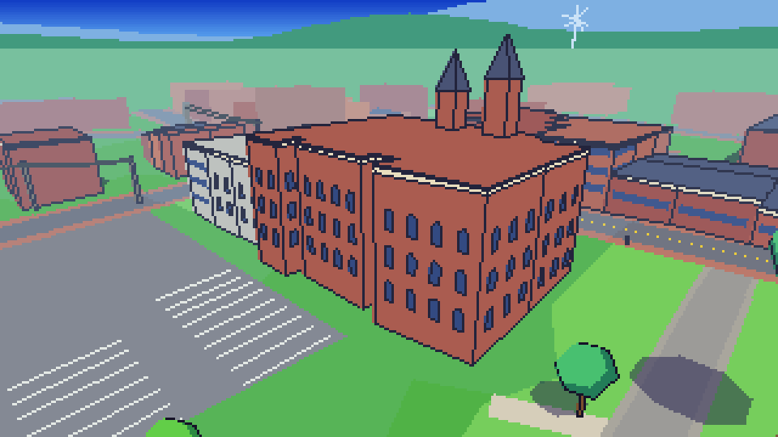 |
| The 1884 post office's clock tower beside the 1888 Court House; shop fronts along Victoria Street | First Baptist's twin towers in red sandstone; Trinity-St. Stephen's bell tower behind |
| 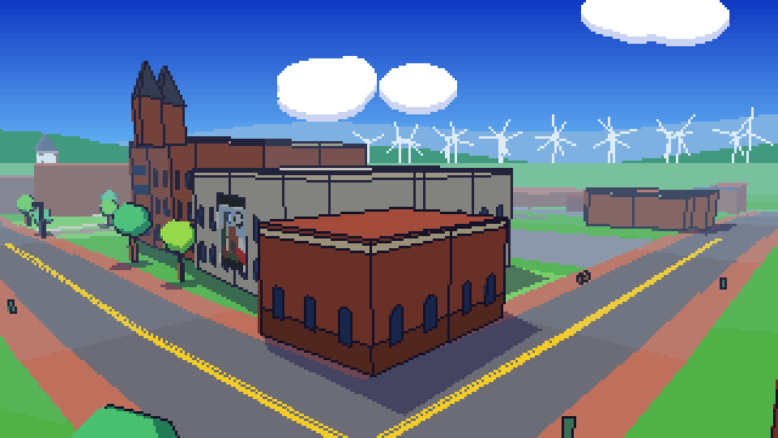 | 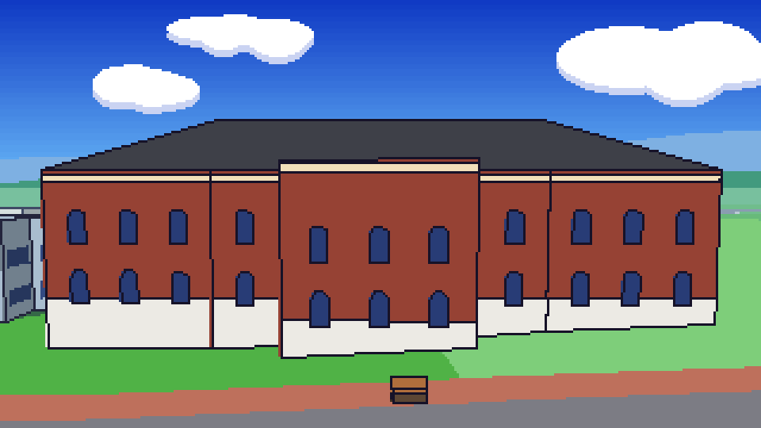 |
| The demolished 1906 Bank of Montreal, back on its corner beside the grey Dominion Building | The demolished c.1911 Hickman Street school: brick on a white base, arched centre |
| 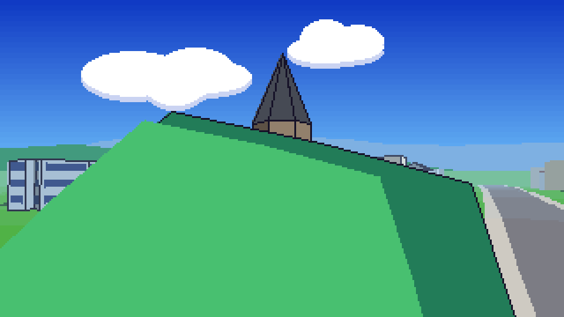 | 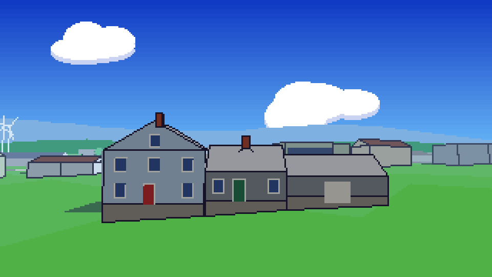 |
| A 1907 Queen Anne house: stone turret and round bay, wrap-around veranda, dormer | An 1840s Classical Revival house with its storey-and-a-half wing and garage wing |
| 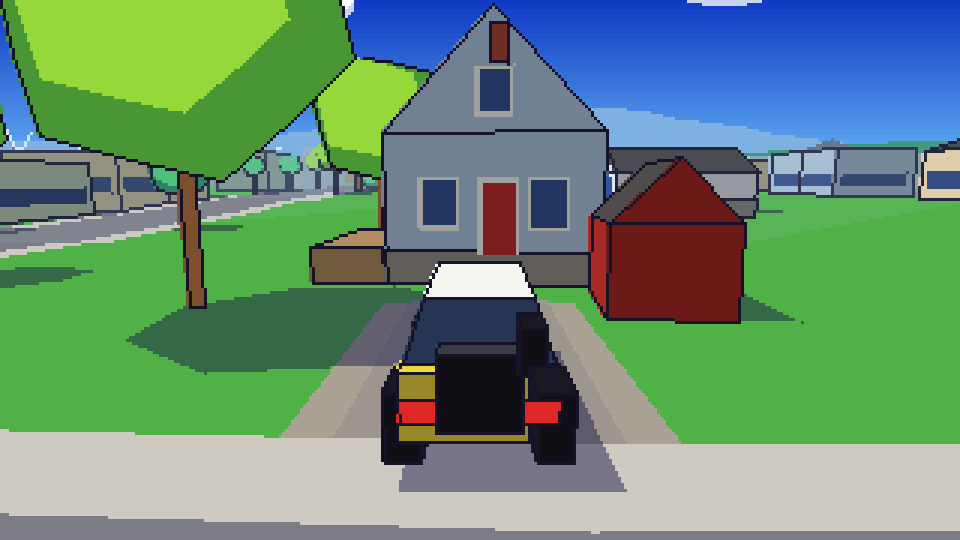 | 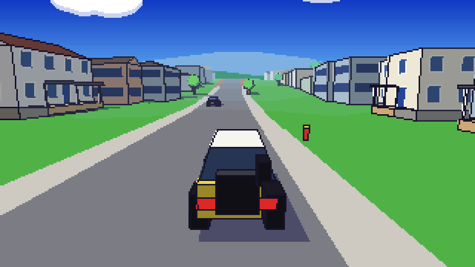 |
| You start in a driveway on a quiet residential street | Houses up close: doors, trimmed windows, foundations, verandas |
| 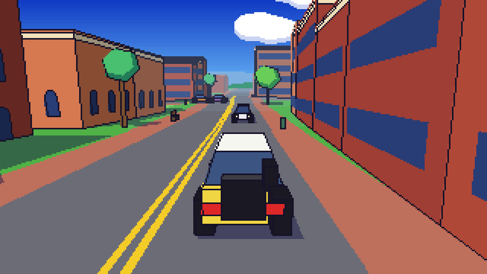 | 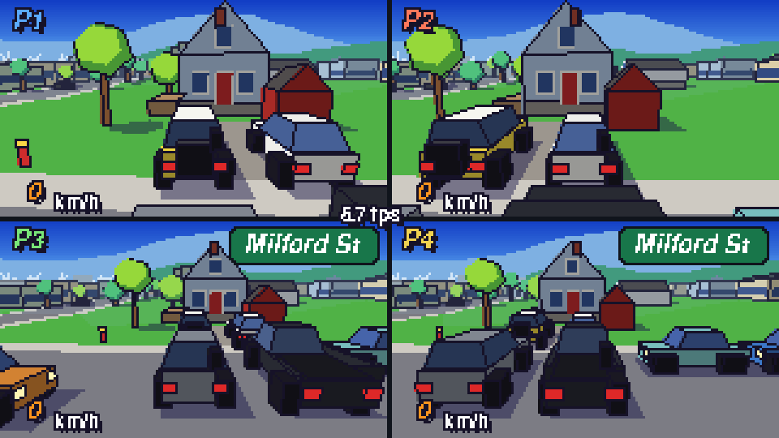 |
| Police chases with a wanted level | 2, 3 or 4 player split screen |
| 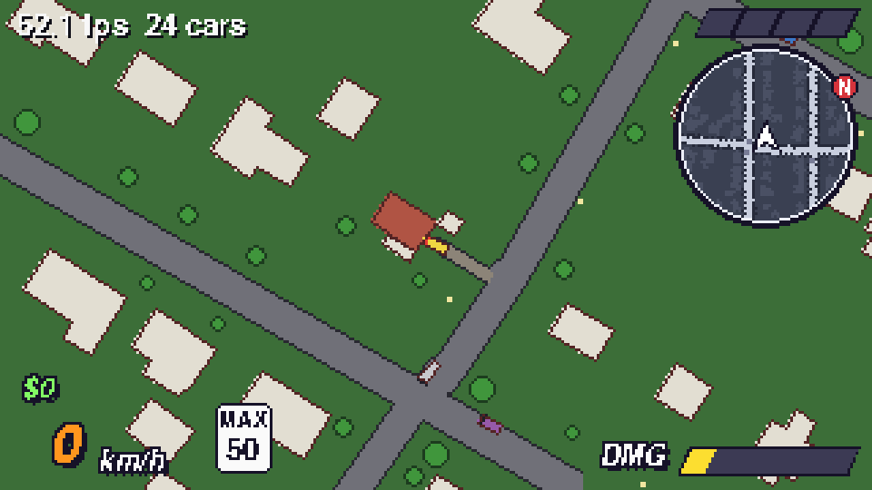 | 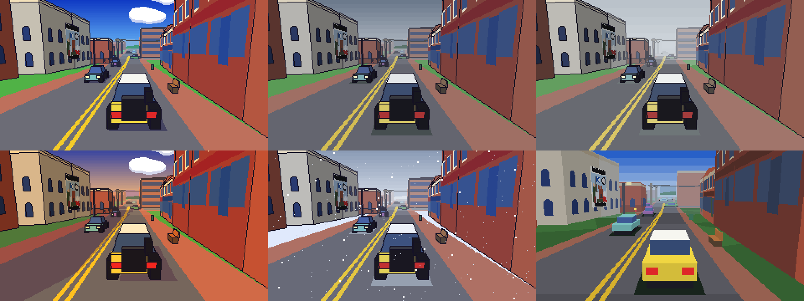 |
| Top-down view (V) | Clear, overcast, coastal fog / golden hour, snow, and the flat-shaded retro style |
| 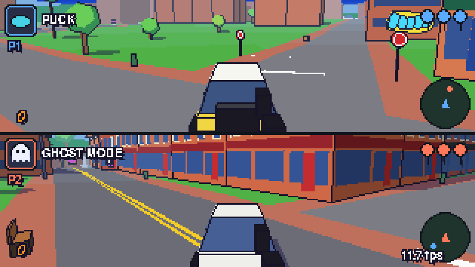 | 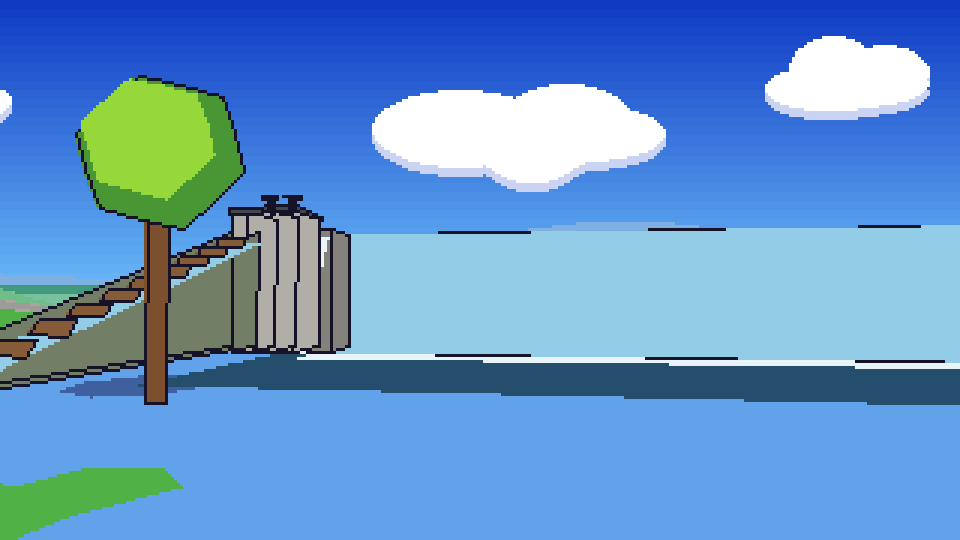 |
| Two player balloon battle: item boxes downtown, the rival's balloons, radar | The Pumping Station dam: spillway, gate works and fish ladder |
| 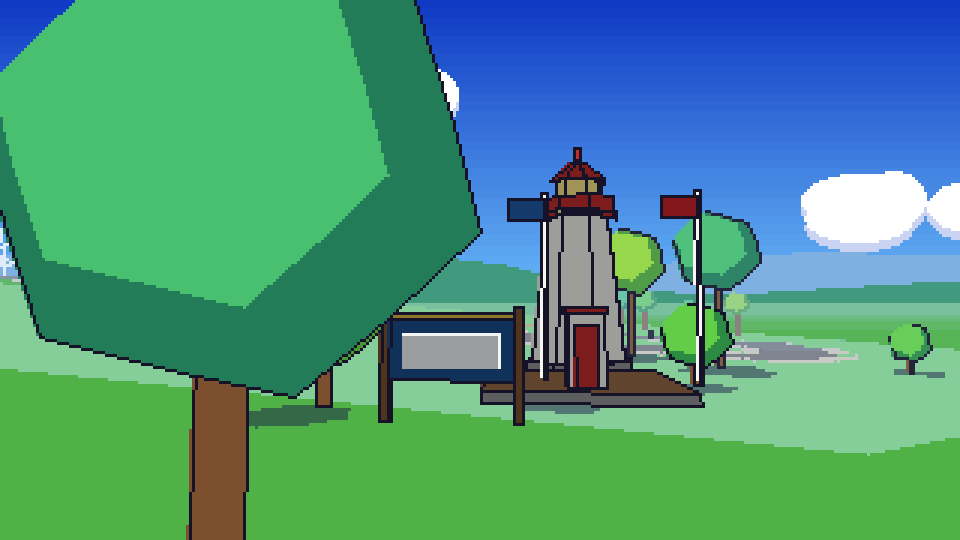 | 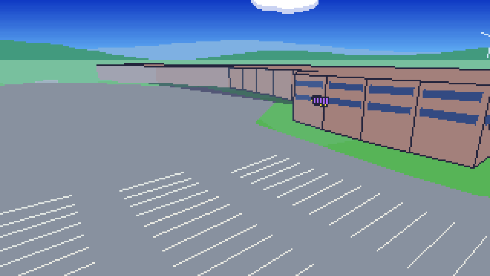 |
| The welcome lighthouse and sign at Highway 104 Exit 1 | Open parking lots with painted stalls (the mall) |

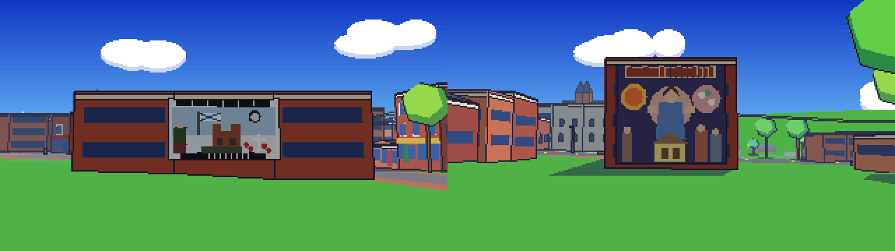

The North Nova Scotia Highlanders memorial at the corner of Ratchford and Havelock Streets and The Great Amherst Mystery
on LaPlanche St (simplified panels of the real murals).

## How Amherst was built
The town is assembled in layers, each from the best source available, and each layer can be refreshed with its own tool:

| Layer | Source | How it gets into the game |
|---|---|---|
| Streets | Nova Scotia Road Network (open data) | `tools/fetch_osm.py` + `tools/nsrn.py`: names, one-ways, overpasses, speed limits |
| Building outlines, parks, landmarks | OpenStreetMap | `tools/osm_to_map.py`; landmarks matched by name and place (`data/landmarks_amherst.json`) |
| Hills | Terrain Tiles on AWS (NRCan CDEM, SRTM) | `tools/fetch_elevation.py`: a 25 m height grid |
| Building heights and roof shapes | NRCan HRDEM LiDAR, 2020 Nova Scotia survey | `tools/fetch_heights.py` (below) |
| House types and their details | measured height, roof pitch, footprint, zoning | `game/archetypes.py` sorts every home into Amherst's common types; the renderer adds doors, windows, verandas |
| House numbers | Nova Scotia Civic Address File | `tools/fetch_addresses.py`; also used to find heritage buildings by street address |
| Woods, zoning | Nova Scotia Topographic Database, the town's zoning map | `tools/fetch_landcover.py`, `tools/zoning_from_pdf.py` |
| Heritage buildings | Canadian Register of Historic Places (facts only) + reference photos | hand-written settings in `data/map_edits.json` and `data/custom_buildings.json` |

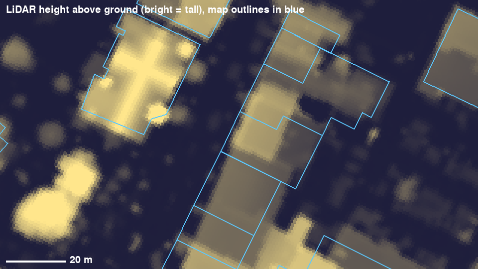

**Measuring every building.** NRCan publishes Nova Scotia's 2020 LiDAR survey as two province-wide 1 m grids, the
ground and the surface including rooftops, each a 57 GB cloud-optimised GeoTIFF. `tools/cog.py` reads just the 124
tiles under Amherst over HTTP range requests (about 250 MB), with a small pure-Python LZW decoder and the Canada
Atlas Lambert projection, so no GIS library is needed. `tools/fetch_heights.py` then lines the OpenStreetMap outlines
up with the roofs (they sit about 3 m apart, measured per 500 m neighbourhood), and for each building takes the
surface-minus-ground heights inside its outline and fits a flat, gabled or hipped roof, trying both ridge directions.
Trees over small houses are caught and skipped. 4,956 of the 5,160 buildings get a measured height and roof.

**Heritage buildings.** Each registered place was matched to its building through its street address, then modelled
from the register's facts (storeys, stone, roof, towers, windows) without copying its text. Buildings missing from
OpenStreetMap, and the two that have been demolished, are placed as custom buildings; LiDAR height maps were used to
check each placement, which is how the two demolished sites showed up as bare ground. Reference photos were used for
the look only; positions always come from the data.

**What wins.** Hand edits beat LiDAR, LiDAR beats the zoning-based guesses, and those beat the converter's defaults, so
fixing one building never means fighting the pipeline. No Google Maps data is used anywhere.

**Built with an AI pair programmer.** The game was developed with [Claude Code](https://claude.com/claude-code), working
step by step with Jeremy: researching the open datasets, writing the tools and renderer features, checking every
change against the test suite (400+ headless tests) and a frame-time benchmark, and committing each working step.
Jeremy chose the direction, knows the town, picked the reference photos and decided anything that needed local
knowledge, like where the demolished buildings stood and where the game starts.

## Contents
[How Amherst was built](#how-amherst-was-built) | [Get the game](#get-the-game) | [Play](#play) | [Controls](#controls) | [The game](#the-game) | [Maps and landmarks](#maps-and-landmarks) |
[Development](#development) | [Making a release](#making-a-release) | [Credits and licence](#credits-and-licence)

## Get the game
Clone the repository (`git clone https://github.com/jeremylegere-wq/amherst-run.git`) or use **Code > Download ZIP** on
GitHub, then follow the section below for your device. When there are tagged versions, `amherst-run-vX.Y.Z.zip` and
`SHA256SUMS.txt` are on the [Releases](https://github.com/jeremylegere-wq/amherst-run/releases) page. You need Python 3.11
to 3.13 (all tested in CI) and pygame; numpy is the only other dependency. **Python 3.14:** pygame has no ready-made
3.14 package on PyPI yet, so `pip install` tries to build it and usually fails. Use Python 3.13, or your Linux
distribution's own pygame (for example `sudo apt install python3-pygame python3-numpy`).

## Play

### Desktop (Windows, macOS, Linux)
```
python -m venv .venv
.venv\Scripts\activate          # Windows   (macOS/Linux: source .venv/bin/activate)
pip install -r requirements.txt
python -m game.main
```
The game opens fullscreen and keeps the 16:9 picture undistorted (black bars if your screen is a different shape).
Press ESC to quit. For a window instead, set `FULLSCREEN = False` in `game/config.py`; `--scale 3` then sets its size.

Useful options: `--style retro` (chunky flat-shaded look with banded fog; the default `street` style is cel-shaded with ink outlines),
`--view top` (start top-down), `--traffic 0` (no civilian cars), `--no-cops` (cop-free), `--no-zoning`, `--flat` (ignore real elevation: faster), `--weather snow` (clear/overcast/fog/golden/snow), `--heat 2` (start with two wanted stars),
`--seed 7` (different traffic), `--start X,Y` (start on the road nearest that map point, in metres), `--map data/sample_map.json` (the small test town), `--no-joy` (ignore gamepads),
`--version`.

### Batocera (Xbox-style controller)
1. Copy the `amherst-run` folder to `/userdata/roms/ports/` (from a PC: `\\batocera\share\roms\ports\` or
   `smb://batocera.local/share/roms/ports/`).
2. Put `AmherstRun.sh` where EmulationStation can see it: it is inside the folder, and you can copy it up one level
   into `ports/`. It must keep Unix (LF) line endings.
3. In EmulationStation, update the game lists (Start > Game Settings > Update Gamelists) and launch **AmherstRun**.

Batocera needs `python3` with `pygame`.

### Android (Pydroid 3)
1. Install **Pydroid 3** from the Play Store (and `pygame` from its Pip menu if prompted).
2. Copy the `amherst-run` folder onto the phone.
3. Open `play_android.py` in Pydroid 3 and press play.

Touch buttons appear automatically. A paired Bluetooth controller also works. `play_android.py` starts with `--debug-input`,
which shows a yellow status line at the bottom (controller found, buttons pressed); delete that flag from the file once the
controls behave. On a desktop, `python -m game.main --touch` shows the same buttons and mouse clicks act as touches.

## Start screen and multiplayer

The game opens on a start screen: **1 Player** is the full game; **2, 3 or 4 Player** is split screen free roam with no
police, no jobs and no damage; **Battle** and **VS Race** are two player modes with items (below). Use the arrows or W/S and Enter (or 1-4), a gamepad D-pad and A, or tap/click an option.
ESC goes back to the start screen. `--players 2|3|4` jumps straight in; `--no-menu` jumps into 1 player.
With 3 players, player 1 gets the whole top half and players 2 and 3 share the bottom.

| Player | Vehicle | Keyboard | Gamepad |
|---|---|---|---|
| 1 | boxy retro SUV (yellow, white roof) | W/A/S/D, Space = handbrake, Left Shift = hop, R = respawn | pad 1 when there are as many pads as players |
| 2 | compact crossover (white) | Arrows, Right Ctrl / Keypad 0 = handbrake, Right Shift = hop, Backspace = respawn | pad 2 |
| 3 | mid-size SUV (grey) | - | pad 3 |
| 4 | quad cab pickup (black) | - | pad 4 |

Pads go to the LAST players first: with two players and one pad the pad drives player 2 and the keyboard keeps player 1.
On a pad A is handbrake, **LB or RB hop**, Start respawns. A freight train passes along the rail line every few minutes
(`--no-train` turns it off). The vehicles are original low-poly designs with no badges.

### Battle and VS race (2 players)

**Battle** is a balloon battle downtown: three balloons each, trailing behind your car. Item boxes wait at junctions
(back 8 s after you take one); a shot, a slick or a hard ram pops a balloon, and the last car with a balloon wins.
**VS Race** starts you side by side somewhere in town and sends you both to a random landmark (Victoria Square, the
Court House, the Dominion Building, the mall, the Pumping Station dam or the border lighthouse) under a tall beacon;
the HUD shows the distance and an arrow, and items slow the other car down. `--vs battle` or `--vs sprint` skips the
start screen. Tab splits the screen top/bottom (default) or left/right; Enter or Start after a win is a rematch.

| | Drive | Hop and drift | Use item |
|---|---|---|---|
| Player 1 | W/A/S/D | Space | E or Left Shift |
| Player 2 | Arrow keys | Right Shift or Enter | / or Right Ctrl |
| Gamepad | Left stick or D-pad | A, LB or RB | X or B |

Items (all original): **Puck** flies straight and bounces off buildings up to four times; **Seeker** homes on the
other car; **Oil slick** drops behind you and spins out whoever drives over it; **Turbo can** is a two second burst
(ram while it lasts to pop a balloon); **Ghost mode** makes you untouchable and faster for six seconds; **Triple puck**
circles your car, blocks incoming shots and fires one at a time.

### Hop and drift boost (all modes)

Tap a bumper to hop. Hop while steering at speed and you start a power slide: the car swings out and turns tighter, and
sparks show the charge (blue, then orange, then purple). Keep holding the bumper, then let go for a speed boost with a
flame out of the back. Steering into the turn tightens it; steering out widens it.

## Controls

| Action | Keyboard | Xbox-style controller | Touch |
|---|---|---|---|
| Steer | Left / Right, A / D | Left stick or D-pad left/right | `<` and `>` |
| Throttle | Up, W | Left stick or D-pad up | GAS |
| Brake / reverse | Down, S | Left stick or D-pad down | BRAKE |
| Handbrake | Space | A | HAND |
| 3D / top-down view | V | B | VIEW |
| Overview map (street names) | M | Y | MAP |
| Respawn | R | Start | RESET |
| Quit | Esc | Back / Select | Android back button |
| Hop / drift boost | Shift | LB or RB | - |
| FPS and polygon count | F3 | - | - |
| Minimap on/off | F2 | - | - |
| Weather: clear, overcast, coastal fog, golden hour, snow | F4 | - | - |
| Build mode (see below) | B | - | - |
| Add a wanted star (debug) | H | - | - |
| Cop-free mode on/off | C | X | - |

Only real gamepads are used (at least 2 axes and 6 buttons); phone sensors that pretend to be joysticks are ignored.

## The game
**Jobs.** Glowing beacons mark jobs at the landmarks. Pull up and stop inside one:
- **Orange - Dominion Building (the old post office): Parcel Run.** Deliver 1-3 parcels to real street addresses before
  the clock runs out. Fragile parcels break if you take 25% damage.
- **Red - Bank: Getaway.** You start with three stars. Lose the police within two minutes.
- **Green - Victoria Square / Museum: Heritage Tour.** A checkpoint race past the town's landmarks.
- **Blue - Court House: Pay your fines.** $100 per wanted star clears the police off your back.

Jobs pay cash plus a time bonus. You can't take a job while wanted, and getting busted costs $100. Follow the arrow under
the timer; the target also sits on the edge of the radar.

**The town.** Civilian cars drive the real road network on the right at the speed limit (a little over or under, driver by
driver), slowing for corners and for cars ahead. They stop on red, make a full stop at stop signs, give way from side
streets, take turns at four-way junctions, wait for oncoming traffic before turning left and don't block a jammed
junction. They are created and removed around you. Hit one and you get heat (red boxes, top right). More heat means more police: they path
along the roads, or cut straight across when they can see you. Stay out of sight for about 8 seconds and the heat drains.
Let them box you in while nearly stopped and you are BUSTED. Damage (bottom right) slows the car; at 100% it is WRECKED.

**Props.** Trees and lamp posts come from OpenStreetMap where mapped and are added along every street where not (the same
every time). They are solid, so mind the trunks.

## Maps and landmarks
The release includes a converted Amherst map (`data/amherst_map.json`) and the landmark list
(`data/landmarks_amherst.json`): the Court House (with an optional clock tower), Victoria Square and its war memorial, the
Dominion Building, banks, churches, the County Museum, the border welcome lighthouse, the wind farms on the skyline and a
red sandstone downtown. You start in a driveway on a residential street in the north-east of town; the start point and
any hand-placed trees live in `data/map_edits.json` (see [docs/EDITOR.md](docs/EDITOR.md)). Press M in the game for the labelled town map. The round minimap (top right) shows the streets around you, the green sign
at the bottom names the street you are on and the white "MAX" sign shows its limit. Highway 104 crosses Highway 2 (Exit 4)
and Highway 6 (Exit 3) on overpasses you can drive over and under. Where a street just stops there is a cul-de-sac to
turn round in, and at both map edges Highway 104 loops round onto its other carriageway so you can head back.

Streets come from the Nova Scotia Road Network (names, one-ways, bridges); buildings, parks and landmarks come from
OpenStreetMap. The NSRN has no speed limits, so limits are estimates by road class; set real ones in
`data/speed_overrides.json`.

### Street detail
Roads are painted the Canadian way: yellow centre lines on two-way arterials, yellow dashes on collectors, white lane
lines on three-lane roads, white edge lines (yellow on the left of one-way carriageways) on Highway 104 and its ramps,
and no paint on local streets, driveways or gravel. Gravel roads (NSRN "Unpaved" and tracks) are tan. Streets have
concrete sidewalks, and the sandstone downtown has red brick ones. OpenStreetMap's real stop signs, traffic signals,
crosswalks and rail crossings become stop bars with signs, signal heads that take turns, zebra crosswalks and
crossbucks. Hydrants, and benches and bins downtown, are placed along the streets by rule because Amherst's OSM has
none of them mapped (the OSM data has no sidewalks or footpaths either, so those are drawn by rule too). The paint rules
are in `game/streetdetail.py`; the traffic rules at junctions (lights in step with the signal heads you see) are in
`game/junctions.py`.

### Hills (real elevation)
Amherst is not flat. `data/elevation.json` (included) holds real ground heights every 12.5 m from the 2020 LiDAR survey's
bare-earth model (`python tools/fetch_lidar_ground.py` rebuilds it from the survey's 8 m overview): road cuts, the rail
embankment, river banks and the drop at the Pumping Station dam are real shapes. The game draws the land in 25 m cells,
split into the fine ones within 75 m of you; roads, buildings, trees and cars sit on it, and you speed up downhill and
slow uphill. At load every road is graded into that ground the way real roads are built: narrow gullies filled, short
humps cut and the profile smoothed (`game/grading.py`), so roads flow and junctions meet; overpass decks run straight
between their embankments. `python tools/road_check.py` drives every road and reports anything a car would hit.
`--flat` ignores the heights (faster on slow machines). `python tools/fetch_elevation.py` makes the older 25 m grid
(Terrain Tiles); `python update_map.py` fetches it the first time if it is missing.
`--radius 4000` limits it to the area around the spawn point; `--from-asc FILE` uses your own ESRI ASCII grid in
latitude/longitude. Hills are stretched 1.5x (`VERTICAL_SCALE` in `game/terrain.py`) so they read on a small screen.

### Weather and time of day
`--weather overcast|fog|golden|snow` (or **F4** in the game) switches between a clear day, grey maritime overcast, coastal
fog that hides the skyline, golden hour with long warm shadows, and winter snow with falling flakes. The presets are
style data in `WEATHER` in `game/render3d.py`, so they work with both the street and the retro style.

### Real building heights (LiDAR)
`data/building_heights.json` (included) holds the measured height and roof shape of 4,956 of the 5,160 buildings, from
Natural Resources Canada's 1 m LiDAR elevation models (survey NS-NSDNR_2020). Refresh it with
`python tools/fetch_heights.py`: it reads only the 512 m tiles under the town from the province-wide cloud files (about
250 MB the first time, cached in `data/.lidar_cache`), lines the OpenStreetMap outlines up with the LiDAR roofs, and fits
each roof. Hand edits in `data/map_edits.json` still win over the measurements.

### Houses
Homes are sorted into Amherst's common types from their measured height, roof pitch, footprint and zoning district
(`game/archetypes.py`): garage, mini-home, bungalow, storey-and-a-half cape, two-storey (about half with a front veranda)
and apartment block. Up close (45 m) each type gets a foundation, trimmed windows by storey, a front door on the
street side, siding up into the gables with an attic window, and verandas; further away they keep the cheap look.
Hand-modelled houses can also have dormers, round towers and bays with cone roofs, wrap-around verandas and chimneys.
Set a house's type by hand with `"arch"` in `data/map_edits.json` (see [docs/BUILDING.md](docs/BUILDING.md)).

### Heritage buildings
Downtown's registered heritage buildings are modelled from the facts in the Canadian Register of Historic Places
(storeys, stone, roof, towers): the 1888 Court House, the old post office with its clock tower, the Dominion Building
in light grey sandstone, the 1907 Bank of Nova Scotia, an 1897 sandstone shop, the railway station, the Armoury, and
the churches (Trinity-St. Stephen's castellated bell tower, First Baptist's twin towers, Christ Church with no steeple).
Houses on the register are modelled from reference photos too: the 1907 Queen Anne house at 177 Victoria Street East
(stone turret, round bay, wrap-around veranda), the 1840s Classical Revival house at 233 Victoria Street East with its
wing and garage, and the Second Empire Moffatt House on Church Street (mansard roof, dormers, bay window).
The demolished Bank of Montreal (1906) and Hickman Street school (c.1911) are back, placed approximately where the
register puts them. Downtown blocks get shop fronts with display windows, sign bands and upper-storey windows up close.

### Real house numbers
`data/addresses.json` (included) has the Nova Scotia Civic Address File points for the map area. Parcel jobs use the real
number nearest the drop point on the same street. Refresh it with `python tools/fetch_addresses.py`.

### Map editor
Fix the map with the mouse (move, reshape, delete or add buildings and roads, find buildings on roads):
`python tools/map_editor.py`. Edits survive re-downloading the map. See [docs/EDITOR.md](docs/EDITOR.md).

### Build your own buildings
Press **B** in the game to drop buildings beside the street (presets, roofs, saved automatically), or edit
`data/custom_buildings.json`. The full guide is in [docs/BUILDING.md](docs/BUILDING.md).

To rebuild the map from OpenStreetMap yourself (the NSRN streets are applied automatically):
```
python tools/fetch_osm.py --convert      # downloads data/amherst.osm and writes data/amherst_map.json
```
Options: `--radius 4000` (bigger area; the default is a 6 x 6 km square over downtown, the south end and Highway 104),
`--bbox SOUTH WEST NORTH EAST`, `--place "Springhill, Nova Scotia"`, `--print-query`. The converter prints a report of which
landmarks it found; if one is `NOT FOUND` or lands on the wrong building, edit its `names` or `near` in the landmark file and
convert again. If the download fails (busy servers), run the query at https://overpass-turbo.eu, export raw OSM data to
`data/amherst.osm`, then `python tools/osm_to_map.py data/amherst.osm data/amherst_map.json`.
`data/amherst.osm` is not kept in the repository because it is large and easy to regenerate.

## Zoning and cop-free mode

- `data/zoning.json` holds the town's zoning districts (from the 2025.11.24 zoning map, Prov. of NS) on a 10 m grid.
  When the game loads the map, plain buildings take the look of their zone so each district reads as one place.
  Re-make it with `python tools/zoning_from_pdf.py Amherst_Zoning.pdf` (needs poppler's `pdftoppm`). The extraction is
  approximate. Skip it with `--no-zoning`.
- `--no-cops` (or **C** in game) turns the police, wanted level and busting off, for a relaxed drive.

### Real trees

The trees stand where real ones do. `data/lidar_trees.json` (included, about 460,000 trees) holds every tree top the
2020 LiDAR survey shows: canopy height (surface model minus ground model, 4 m overview) peaking above its neighbours in
every direction, with its real height (capped at 24 m) and a crown that grows with it. Woods, tree lines, yard trees
and street trees all come from it, planted area by area as you drive, kept off roads and 3 m clear of buildings.
`python tools/fetch_lidar_trees.py` rebuilds it (Open Government Licence - Canada).

Where the survey has no data (across the border in New Brunswick), the game plants random trees in the real treed
areas instead: `data/landcover.json` (included) comes from the Nova Scotia Topographic Database land cover layer. Refresh it with `python tools/fetch_landcover.py` (standard library only). If the download is blocked, save the GeoJSON from
`https://data.novascotia.ca/api/geospatial/xed8-vvg5?method=export&format=GeoJSON` and run
`python tools/fetch_landcover.py that_file.json`. Credit: "Contains information licensed under the Open Government
Licence - Nova Scotia."

## Development
Project layout: `game/` (the game), `tools/` (map pipeline, autopilot, benchmarks, release scripts), `tests/`, `data/`.

### Run the checks locally
These are the same commands CI runs. Set the dummy video/audio drivers so no window or sound card is needed
(Windows PowerShell: `$env:SDL_VIDEODRIVER="dummy"; $env:SDL_AUDIODRIVER="dummy"`).
```
pip install -r requirements.txt
export SDL_VIDEODRIVER=dummy SDL_AUDIODRIVER=dummy

python -m unittest discover -s tests -v                                   # all tests
python -m game.main --frames 120 --autodrive                              # headless smoke run
python -m game.main --map data/sample_map.json --style retro --frames 120 --autodrive
pip install ruff==0.16.9 && ruff check --select E9,F63,F7,F82 .          # syntax errors / undefined names
```
Handy extras: `python tools/readme_shots.py` regenerates every picture in this README (docs/images);
`python -m game.main --frames 240 --autodrive --screenshot screenshots/drive.png` saves a frame;
`python tools/autopilot.py` has a robot play the jobs to check the timers are fair; `python tools/bench_render.py` and
`python tools/bench_town.py [data/amherst_map.json]` benchmark the renderer (budget: 33 ms per frame for everything).

### Continuous integration
`.github/workflows/ci.yml` runs on every pull request, on pushes to `main`, every Monday on its own (to catch breakage
from outside: new runner images or library releases), and from the **Run workflow** button on the Actions tab. Each job
compiles every Python file, runs the unit tests and three headless smoke drives:

| Job | Why it is there |
|---|---|
| Linux, Python 3.11 with pygame 2.5.2 + numpy 1.24.4 | Batocera parity: the oldest versions `requirements.txt` allows, which is what Batocera ships |
| Linux, Python 3.11 / 3.12 / 3.13 (newest pygame and numpy) | The newest releases a desktop install gets |
| Windows and macOS, Python 3.13 | The desktop quick start |
| Linux, Python 3.14 (install probe) | Known gap: no pygame wheels for 3.14 on PyPI yet. While pip cannot install pygame it passes with a warning; once it can, it runs every check for real |

Plus the `ruff` lint (bug-finding rules only) and a check that the release zip builds, has the right contents and runs
when unpacked. The release workflow re-runs all of it on the tagged commit. Third-party actions are pinned to commit SHAs
and kept current by Dependabot (which must not raise the pygame/numpy minimums: Batocera needs them).

When a check is red:
1. Open the failed job and read the first error, not the last line. `Show the versions under test` says which Python,
   pygame and numpy it had.
2. Only one Python or OS failing usually means a newer-only feature (syntax or a library call). Batocera's job failing
   means something needs a newer pygame/numpy than Batocera has: rewrite it to work on both, do not raise the minimums.
3. Reproduce locally if you can (`SDL_VIDEODRIVER=dummy SDL_AUDIODRIVER=dummy python -m unittest discover -s tests`), fix,
   push, and wait for green before tagging anything. A failure in the weekly run with no code change is an outside
   change: pin or work around it in a normal commit.
4. When pygame ships Python 3.14 wheels, the 3.14 probe stops warning and runs the tests: then remove `probe: true`.
   Do not use `continue-on-error` on a whole job to tolerate a known gap: the job still files a failed check, and
   GitHub shows main as failing.

## Making a release
Versions follow [Semantic Versioning](https://semver.org/) (`0.x` while the game is still being tuned; a breaking change to
controls, save data or map format bumps the minor version until 1.0). The single source of truth is `__version__` in
`game/__init__.py`. Git tags are `v` plus that version, for example `v0.2.0`, or `v0.2.0-rc.1` for a pre-release.

1. Make sure `main` is green in CI and your working copy is up to date: `git checkout main && git pull`.
2. If the look changed, refresh the README pictures: `python tools/readme_shots.py`.
3. In `CHANGELOG.md`, move the "Unreleased" items into a new `## [X.Y.Z] - YYYY-MM-DD` section and update the link references.
4. Set `__version__ = "X.Y.Z"` in `game/__init__.py`.
5. Check everything agrees (prints the release notes, fails if the version, tag or changelog disagree):
   `python tools/release_notes.py X.Y.Z`
6. Commit and push to `main`: `git commit -am "Release vX.Y.Z" && git push`. Wait for CI to pass.
7. Tag and push the tag: `git tag -a vX.Y.Z -m "Amherst Run X.Y.Z" && git push origin vX.Y.Z`.
8. Watch the **Release** run under the repository's Actions tab. It re-runs CI, refuses to continue if the tag is not on `main`
   or does not match the version and changelog, builds `amherst-run-vX.Y.Z.zip` plus `SHA256SUMS.txt` from the tagged commit,
   and creates a **draft** GitHub Release with the changelog section as its notes.
9. Open the draft under Releases, check the notes and the two attached files (download the zip, unpack it, run
   `python -m game.main --frames 60 --autodrive`), then press **Publish release**.

If a release run fails before the draft exists, fix the problem, then delete the tag (`git push --delete origin vX.Y.Z` and
`git tag -d vX.Y.Z`) and tag again. To build the zip locally from committed files: `tools/build_release_zip.sh X.Y.Z dist`.

## Credits and licence
Map data (c) OpenStreetMap contributors, available under the [Open Database Licence](https://opendatacommons.org/licenses/odbl/).
Road data: Nova Scotia Road Network, from the Province of Nova Scotia open data portal, used under the Open Government
Licence - Nova Scotia. Check the licence page for the exact attribution wording before you publish.
Civic addresses (`tools/fetch_addresses.py`, `data/addresses.json`): Nova Scotia Civic Address File, from the Province of
Nova Scotia open data portal. Contains information licensed under the Open Government Licence - Nova Scotia.
Elevation (`data/elevation.json`, `tools/fetch_elevation.py`): Terrain Tiles on AWS (Mapzen; sources include NRCan CDEM and
SRTM).
Building heights (`data/building_heights.json`, `tools/fetch_heights.py`): Natural Resources Canada, High Resolution
Digital Elevation Model (HRDEM), LiDAR project NS-NSDNR_2020. Contains information licensed under the Open Government
Licence - Canada.
Land cover and zoning: Province of Nova Scotia; contains information licensed under the Open Government Licence - Nova Scotia.
Heritage facts: Canadian Register of Historic Places (historicplaces.ca), via the Wikipedia list of historic places in
Cumberland County; only facts (storeys, materials, roof, towers) are used, no text.
All code, art and names in this project are original.

**Licence.** The code is released under the [MIT License](LICENSE). The data files in `data/` keep their own licences
listed above (OpenStreetMap data stays under the ODbL, provincial data under the Open Government Licence - Nova Scotia):
if you share the map data, keep those credits with it.
